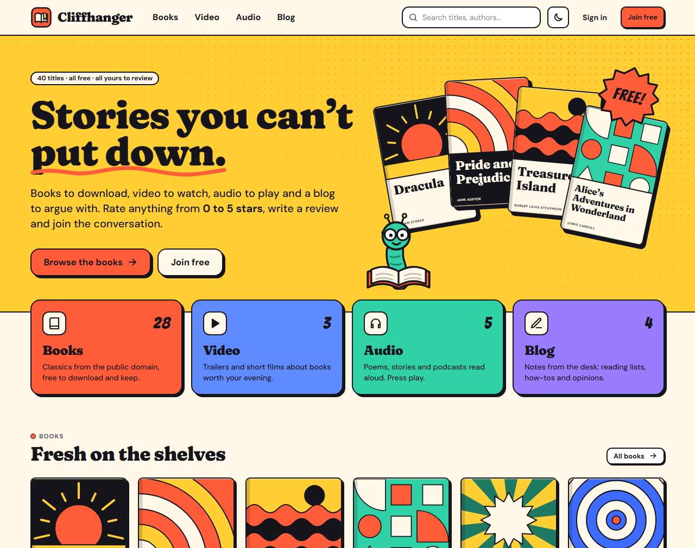
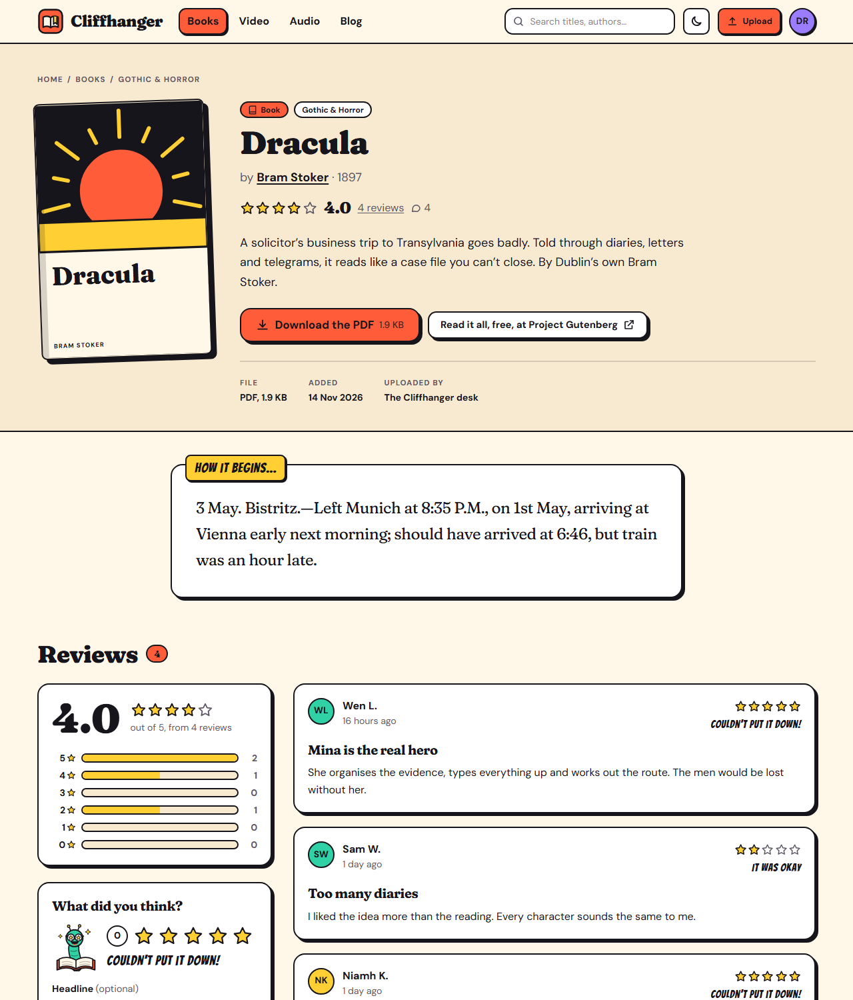

# Cliffhanger

A bookshop-style library for **books, video, audio and blog posts**, where members can rate anything
from **0 to 5 stars**, write reviews and talk in comment threads.

Built with **Laravel 13, Blade, Tailwind CSS 4 and Alpine.js**. No JavaScript framework and no CDN:
every font, script and style is served by the site itself.





## Where it came from

This started in 2023, during a seven-month internship at a software company, as a Laravel 9 "book site":
members uploaded a book as a PDF with a thumbnail, and admins managed books, categories and users.
The brief kept growing (video uploads next, then podcasts), with one firm rule: **everything had to be
stored in the same table**. That version stopped at an empty `podcasts` table.

This is the rebuild. The 2023 code is kept, untouched, under the
[`2023-original`](https://github.com/rlucas2100/laravel-booksite/tree/2023-original) tag.

## What it does

- **Four kinds of entry on one set of shelves**: books (PDF), video (MP4/WebM), audio (MP3/M4A/OGG/WAV)
  and articles (Markdown).
- **Star reviews from 0 to 5**, one per member per entry, with a headline and text. The mascot on the
  review form changes his face as you pick a score. Averages and a score chart on every entry.
- **Comments with replies** under every entry, drawn as speech bubbles.
- **Prices, a basket and a checkout**: any entry can have a price in pounds. Buyers pay on Stripe's hosted
  Checkout page (test mode in the demo, so no real money moves), and what they buy is unlocked in "My library".
- **Upload form** that changes with the type you pick, accepts drag and drop, checks file type and size
  before sending, and reads a recording's length in the browser.
- **A cover is drawn for anything uploaded without one**: nine motifs in ten palettes, chosen from the
  entry's address so the same entry always looks the same.
- **A cassette-style audio player** (skip 15 seconds, change speed, remembers where you stopped) and a
  video player. Files are streamed with range requests, so you can skip around.
- **Search, filters and sorting** (newest, top rated, most talked about, A to Z), categories, light and
  dark themes, and layouts for phones.
- **Accounts and roles**: member, admin and owner, using policies and
  [spatie/laravel-permission](https://github.com/spatie/laravel-permission). An admin area for the
  catalogue, members, categories, and moderating reviews and comments.

## One table for everything

The answer to "how do I store books, videos and podcasts in the same table?" is a `type` column:

| File | What it does |
| --- | --- |
| [`database/migrations/..._create_entries_table.php`](database/migrations/2026_11_16_060100_create_entries_table.php) | One `entries` table. Columns a type doesn't use stay empty. |
| [`app/Enums/EntryType.php`](app/Enums/EntryType.php) | The four types, and everything that differs between them: labels, addresses, accepted files, size limits, cover shape, colour. |
| [`app/Models/Entry.php`](app/Models/Entry.php) | One model. `type` is cast to the enum. |
| [`app/Http/Requests/EntryRequest.php`](app/Http/Requests/EntryRequest.php) | The validation rules follow the type: a book needs a PDF, an article needs its text. |

Because every entry is a row in the same table, reviews, comments and categories each need only one
foreign key (`entry_id`), and one controller and one set of views serve all four shelves. Adding a
fifth type means adding one `case` to the enum.

## Payments

Paying uses [Stripe Checkout](https://stripe.com/payments/checkout) over plain HTTPS calls, with no SDK:
[`app/Support/Stripe.php`](app/Support/Stripe.php).

1. The basket becomes a `pending` order and a Checkout Session is created for it.
2. The buyer pays on Stripe's own page, so no card number ever reaches this site.
3. Back at the shop, the order is only marked `paid` after asking Stripe itself whether the session was paid.
   Stripe also reports it through a signed webhook (`/stripe/webhook`), in case the buyer closes the tab.

Prices are stored as whole pence. In demo mode the code refuses anything but a test key (`sk_test_...`).
To try it, put your Stripe test key in `.env` as `STRIPE_SECRET` and pay with the card `4242 4242 4242 4242`.

## Safe to leave open: the public demo

With `SHOP_DEMO=true` the site can be put online for anyone to try, without becoming a noticeboard for
strangers:

- Everything a visitor creates (an account, an upload, a review, a comment) is tagged with a random
  token kept in a cookie, and is **only shown to that browser**.
- The shop's own books, members and reviews are **locked**, even for the demo admin account.
- Visitors' things are **deleted after 24 hours**, and each visitor can upload only a few files.

It is one trait and one small class: [`app/Models/Concerns/Sandboxed.php`](app/Models/Concerns/Sandboxed.php)
and [`app/Support/Sandbox.php`](app/Support/Sandbox.php), covered by
[`tests/Feature/PublicDemoTest.php`](tests/Feature/PublicDemoTest.php).

## Security

- Policies decide who may edit or delete; checked on the server for every request.
- Uploads are stored outside the public folder under random names and handed out by a controller. The
  `Content-Type` comes from the site's own list, never from the uploaded file.
- Passwords are hashed with bcrypt. Sign-in, sign-up, reviews, comments and uploads are rate limited.
- A Content-Security-Policy that allows no inline scripts and no outside hosts; CSRF tokens on every
  form; Markdown is rendered with raw HTML removed.

## Run it on your own machine

You need PHP 8.3 or newer (with the `pdo_sqlite` extension), Composer and Node 20 or newer.

```bash
composer run setup      # installs everything, creates the SQLite database and fills the shelves
php artisan serve       # http://localhost:8000
```

`npm run dev` rebuilds the CSS and JavaScript as you edit.

On a local machine the seeder makes two accounts to try:

| | Email | Password |
| --- | --- | --- |
| A reader | `reader@example.com` | `turn-the-page` |
| An admin | `admin@example.com` | `shelf-control` |

For an owner account (every permission), set `OWNER_EMAIL` and `OWNER_PASSWORD` in `.env` before seeding.

## Tests

```bash
php artisan test
```

67 tests: browsing and search, uploads for each type, the 0 to 5 star rules, comments and replies,
file access, accounts, the admin area, the public-demo rules, and the basket and checkout (with Stripe faked).

## Putting it on shared hosting

Shared hosting usually has no command line and can't point a domain at Laravel's `public` folder, so
there is a script that builds one self-contained folder to upload by FTP:

```bash
php tools/deploy.php "C:\path\to\website\bookshop" https://example.com/bookshop
```

The site needs PHP 8.3 on the server and installs itself (database and sample content) the first time
it is opened. Its database, sessions and uploads are kept in a `bookshop-data` folder next to the
website folder, so uploading a new version never touches them. See the notes at the top of
[`tools/deploy.php`](tools/deploy.php).

## What's on the shelves

- **Books**: 28 classics that are in the public domain. Each has a short PDF sampler made by the seeder
  and a link to the full text at [Project Gutenberg](https://www.gutenberg.org/). Some carry a demo price
  so the checkout has something to sell.
- **Audio**: five poems read by [LibriVox](https://librivox.org/) volunteers, who give their recordings
  to the public domain.
- **Video**: three short animated trailers made for this project.
- **Reviews and comments**: written for the demo. The readers are made up.

## Author

Made by AstroQuack ([rlucas2100](https://github.com/rlucas2100)).
